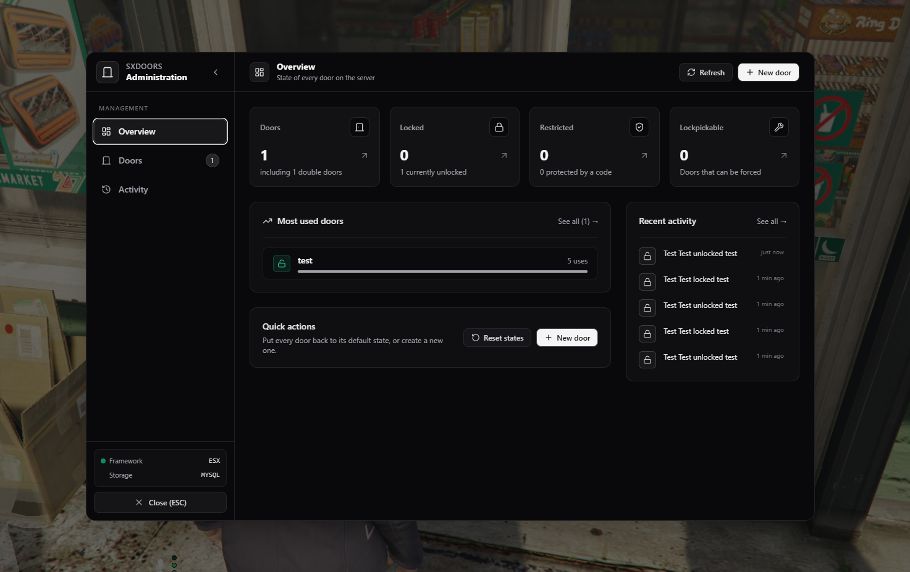
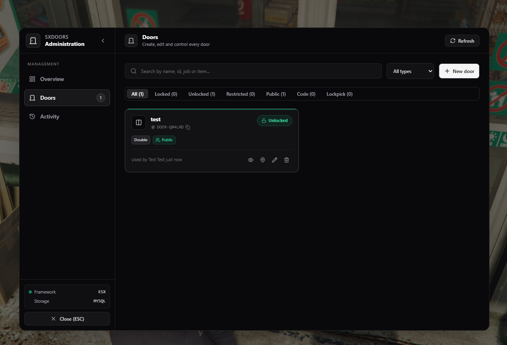
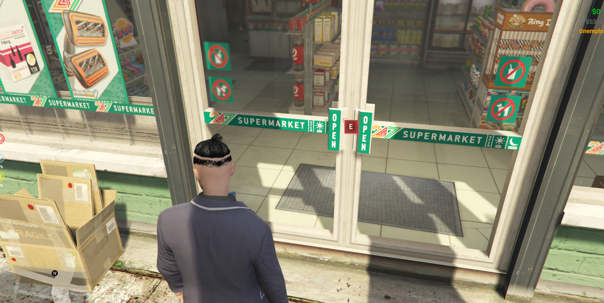

# sxDoors

A FiveM door lock resource for **ESX or standalone** servers. Doors are created in game from a React admin panel by aiming at them, locked with the native door system, and checked by the server for every action.

## Features

- **In game creation**: open the panel, press *Select*, aim at a door and press `E`. Double doors, sliding doors, garages and gates are supported.
- **Native door system**: doors use `AddDoorToSystem`, so they close and lock smoothly, sliding doors and gates open by themselves once unlocked. No entity freezing.
- **Access rules**: ESX jobs with a minimum grade, sxIllegals criminal groups with a minimum rank, items, ACE permissions, identifiers and pin codes. A door with no rule is public. Admins can always open every door.
- **Pin code keypad**: a NUI keypad with keyboard support. Codes are checked by the server only, and players are blocked for a while after too many wrong codes.
- **Server authority**: the server checks the access, the distance between the player and the door and a cooldown for every request. Clients never receive pin codes or access lists.
- **Auto lock**: a door can lock itself a few seconds after being opened.
- **Lockpicking**: lockpickable doors can be forced with the `lockpick` item (ESX) or through an export, with configurable success and break chances.
- **Admin panel**: overview, door list with search and filters, live activity feed, lock / unlock from the panel, show the door in game, teleport, edit, delete, reset every door to its default state.
- **Debug overlay**: `/sxdoors_debug` draws the id, name, state and range of nearby doors.
- **Discord logs**: optional webhook for creations, updates, deletions, lockpicks and wrong codes.
- **Storage**: oxmysql when available, otherwise a JSON file, so the resource runs without a database.
- **Legacy import**: the `sxdoors_migrate` console command imports the doors of the previous `doors` table.
- **Translations**: English and French, shared between Lua and the interface.
- **Exports**: a server and client API to drive doors from your other resources.

<div align="center">





</div>

## Dependencies

None are required.

| Resource | Purpose |
| --- | --- |
| [es_extended](https://github.com/esx-framework/esx_core) | Optional. Jobs, items, ESX admin groups, notifications and the usable lockpick item |
| [oxmysql](https://github.com/overextended/oxmysql) | Optional. Database storage, otherwise doors are saved in `data/doors.json` |
| [sxIllegals](https://github.com/0xS4cha/sxIllegals) | Optional. Access by criminal group and rank |

The server should run with OneSync (default on recent artifacts) so the distance between players and doors can be checked.

## Installation

1. Clone the repository into your `resources` folder.

   ```bash
   git clone https://github.com/0xS4cha/sxDoors.git
   ```

2. Build the interface, or download a release where `web/dist` is already built.

   ```bash
   cd sxDoors/web
   npm install
   npm run build
   ```

3. Add the resource to your `server.cfg` after its optional dependencies.

   ```cfg
   ensure oxmysql
   ensure es_extended
   ensure sxDoors
   ```

4. Give yourself access to the admin panel. ESX `admin` and `superadmin` groups are allowed by default. In standalone, use the ACE permission:

   ```cfg
   add_ace group.admin sxdoors.admin allow
   add_principal identifier.license:xxxxxxxx group.admin
   ```

The `sx_doors` table is created automatically on the first start. `db.sql` is only needed if your database user cannot create tables.

## Usage

| Command / key | Description |
| --- | --- |
| `E` | Lock or unlock the closest door. Can be changed in *Settings > Key Bindings > FiveM* |
| `/sxdoors` | Opens the admin panel. Can be bound to a key |
| `/sxdoors_debug` | Admin only, toggles the debug overlay |
| `sxdoors_migrate` | Server console only, imports the legacy `doors` table |

### Creating a door

1. Open `/sxdoors` and click **New door**.
2. In **General**, set a name, the type, the interaction distance and the options.
3. In **Entities**, click **Select**. The panel hides: aim at the door, press `E` to select each leaf, `Enter` to confirm or `Backspace` to cancel. Entities can also be typed manually (model name or hash and coordinates). The interaction point is the center of the entities, or your position with **My position**.
4. In **Access**, add the rules. A player matching at least one rule can use the door. Leave everything empty for a public door.

### Door types

| Type | Behavior |
| --- | --- |
| `single` | One entity |
| `double` | Two leaves locked and unlocked together |
| `sliding` | One or two entities that slide open automatically when unlocked |
| `garage` | Garage doors and gates that open automatically when unlocked, use a larger distance |

### Access rules

| Rule | Framework | Description |
| --- | --- | --- |
| Jobs | ESX | Job name and minimum grade, `{ police = 2 }` |
| Groups | sxIllegals | Group id and minimum rank, `{ ["GRP-1720000000-AB12"] = 1 }`. Rank `0` is the leader, so a member passes when their rank is lower or equal. `true` accepts every rank |
| Items | ESX | The player holds at least one of the items |
| ACE | All | The player has one of the ACE permissions, for example `add_ace group.lspd sxdoors.lspd allow` |
| Identifiers | All | `license:`, `discord:`, `steam:`, `fivem:` or the ESX identifier |
| Pin code | All | Anyone who knows the code. Asked only when no other rule matches |

## Configuration

Everything lives in `shared/config.lua`.

| Key | Default | Description |
| --- | --- | --- |
| `Config.Framework` | `'auto'` | `'auto'`, `'esx'` or `'standalone'` |
| `Config.Integrations.sxIllegals` | `'sxIllegals'` | Resource name of sxIllegals. Group rules only apply while it is started, `false` disables them |
| `Config.Storage` | `'auto'` | `'auto'` uses oxmysql when started, `'mysql'` or `'json'` force a storage |
| `Config.PersistState` | `true` | Keeps the state of every door across restarts. When `false`, doors start in their default state |
| `Config.Admin.groups` | `{ 'admin', 'superadmin' }` | ESX groups allowed to use the admin panel |
| `Config.Admin.ace` | `'sxdoors.admin'` | ACE permission allowed to use the admin panel |
| `Config.Admin.bypass` | `true` | Admins can open every door |
| `Config.Interaction.key` | `'E'` | Default key |
| `Config.Interaction.prompt` | `'3d'` | `'3d'` text above the door, `'help'` GTA help notification, `'none'` |
| `Config.Interaction.defaultDistance` | `2.0` | Default interaction distance |
| `Config.Interaction.serverTolerance` | `3.0` | Extra distance tolerated by the server |
| `Config.Interaction.cooldown` | `600` | Milliseconds between two interactions of a player |
| `Config.Interaction.animation` | `true` | Plays a key animation |
| `Config.Interaction.sounds` | | Lock, unlock and denied sounds |
| `Config.Pin.minLength` / `maxLength` | `4` / `8` | Length of the codes |
| `Config.Pin.maxAttempts` | `5` | Wrong codes before the player is blocked |
| `Config.Pin.lockout` | `60` | Seconds the player stays blocked |
| `Config.Lockpick.enabled` | `true` | Enables lockpicking |
| `Config.Lockpick.item` | `'lockpick'` | ESX usable item, `false` to only use the export |
| `Config.Lockpick.successChance` | `60` | Chance to unlock the door |
| `Config.Lockpick.breakChance` | `35` | Chance to lose the item |
| `Config.Lockpick.duration` | `6000` | Duration of the lockpick in ms |
| `Config.AutomaticRate` | `1.0` | Speed of sliding and garage doors |
| `Config.ActivityLimit` | `100` | Entries kept in the activity feed |
| `Config.Webhook` | | Discord logs and the events sent |

### Convars

| Convar | Default | Description |
| --- | --- | --- |
| `sx_doors_webhook` | | Discord webhook URL, kept out of the shared config so clients never see it |
| `sx_locale` | | Forces the language, `setr sx_locale fr`. When unset, clients follow the game language and the server uses English |
| `sx_doors_debug` | `0` | `1` prints trace logs |
| `sx_doors_log_level` | `2` | `0` errors, `1` warnings, `2` info, `3` trace |

```cfg
set sx_doors_webhook "https://discord.com/api/webhooks/..."
setr sx_locale "fr"
```

## How it works

```
core/           Module loader, class helper, callbacks, logger, translations, utilities
bridge/         ESX / standalone bridge and oxmysql / JSON storage
modules/
  doors/        Door class, validation, access, persistence and client door system
  admin/        Admin callbacks, activity feed, Discord logs, door picker and debug overlay
  lockpick/     Lockpicking
  ui/           NUI bridge and pin keypad
  exports/      Public server and client API
shared/         Configuration
translations/   Language files, used by Lua and by the interface
web/            React, TypeScript and Tailwind interface
data/           JSON storage when oxmysql is not used
```

The server owns every door. When a player presses the key, the client asks the server through a callback; the server checks the cooldown, the distance and the access, then broadcasts the new state to every client which applies it with `DoorSystemSetDoorState`. Clients only receive what they need to draw and lock doors: no pin code and no access list.

When a pin is required, the server answers `pin_required` and the client opens the keypad. The code is sent back to the server, wrong codes are counted per player and block the player for `Config.Pin.lockout` seconds after `Config.Pin.maxAttempts` failures.

Lockpicking is split in two requests: the server records the start, and only accepts the end once the animation duration has passed, then rolls the success and break chances.

## Exports

All exports return plain tables that can safely be used from other resources. Door ids look like `DOOR-AB12CD`, they can be copied from the admin panel by clicking them.

### Server

##### `GetDoor(id)`

Returns a door or `nil`.

```lua
local door = exports.sxDoors:GetDoor("DOOR-AB12CD")
```

```lua
{
    id = "DOOR-AB12CD",
    label = "LSPD - Main entrance",
    type = "double",
    coords = { x = 434.74, y = -981.91, z = 30.84 },
    distance = 2.5,
    entities = {
        { model = 320433149, coords = { x = 434.74, y = -983.21, z = 30.84 }, heading = 270.0 }
    },
    locked = true,
    defaultLocked = true,
    autoLock = 0,
    lockpick = false,
    hidePrompt = false,
    hasPin = false,
    access = { jobs = { police = 0 }, groups = {}, items = {}, aces = {}, identifiers = {} },
    uses = 12
}
```

##### `GetDoors()`

Returns an array of every door.

##### `GetClosestDoor(coords, maxDistance?)`

Returns the closest door and its distance, or `nil`.

```lua
local door, distance = exports.sxDoors:GetClosestDoor(GetEntityCoords(GetPlayerPed(source)), 5.0)
```

##### `IsDoorLocked(id)`

Returns `true`, `false`, or `nil` if the door does not exist.

##### `SetDoorState(id, locked, source?)`

Locks or unlocks a door for everyone. `source` is only used for the activity feed. Returns `true` when the door exists.

```lua
exports.sxDoors:SetDoorState("DOOR-AB12CD", false)
```

##### `ToggleDoor(id, source?)`

Toggles a door and returns its new state.

##### `CanPlayerUseDoor(source, id, pin?)`

Returns `true`, or `false` and a reason: `not_found`, `denied`, `pin_required`, `pin_wrong`, `pin_blocked`.

```lua
local allowed, reason = exports.sxDoors:CanPlayerUseDoor(source, "DOOR-AB12CD")
```

##### `CreateDoor(data)`

Creates a door and returns its id, or `nil` and an error: `missing_label`, `missing_entities`, `invalid_pin`, `duplicate_id`.

```lua
local id, err = exports.sxDoors:CreateDoor({
    label = "Bank vault",
    type = "single",
    entities = {
        { model = "v_ilev_bk_vaultdoor", coords = { x = 255.23, y = 223.98, z = 102.39 } }
    },
    distance = 3.0,
    defaultLocked = true,
    autoLock = 30,
    access = { jobs = { police = 2 }, items = { "vault_card" } },
    pin = "7351",
})
```

`type`, `coords` (center of the entities), `distance`, `defaultLocked` (`true`), `autoLock` (`0`), `lockpick`, `hidePrompt`, `pin` and `access` are optional. `id` can be given to choose the id.

##### `UpdateDoor(id, data)`

Updates the given fields only and returns `true`, or `false` and an error. Send `pin = ""` to remove a code.

```lua
exports.sxDoors:UpdateDoor("DOOR-AB12CD", { label = "LSPD - Lobby", autoLock = 10 })
```

##### `SetDoorAccess(id, access)`

Replaces the access rules of a door.

```lua
exports.sxDoors:SetDoorAccess("DOOR-AB12CD", { jobs = { police = 0, sheriff = 0 }, aces = { "sxdoors.lspd" } })
exports.sxDoors:SetDoorAccess("DOOR-EF34GH", { groups = { ["GRP-1720000000-AB12"] = true } })
```

##### `DeleteDoor(id)`

Deletes a door and returns `true` when it existed.

##### `LockpickDoor(source, id, skipItem?)`

Runs the lockpick checks and chances for a player near the door. Pass `skipItem = true` when your resource already handled the item, for example after your own minigame. Returns `true`, or `false` and a reason.

```lua
local ok, reason = exports.sxDoors:LockpickDoor(source, doorId, true)
```

##### `GetActivity()`

Returns the activity feed, newest first.

##### `IsAdmin(source)`

Returns `true` if the player can use the admin panel.

### Client

##### `GetDoor(id)` / `GetDoors()`

Same as the server, without the access rules.

##### `GetClosestDoor(maxDistance?)`

Returns the closest door to the player and its distance.

```lua
local door, distance = exports.sxDoors:GetClosestDoor(3.0)
```

##### `IsDoorLocked(id)`

Returns the state of a door known by the client.

##### `UseDoor(id)`

Toggles a door as if the player pressed the key: the server still checks the access and the distance, the keypad opens if a code is needed.

##### `ToggleClosestDoor(maxDistance?)`

Uses the closest door within `maxDistance` (default `3.0`). Returns `false` if there is none.

##### `LockpickClosestDoor()`

Starts lockpicking the closest lockpickable door. Plug it into your own item or target system.

```lua
exports.ox_target:addGlobalObject({
    { label = "Lockpick", icon = "fa-solid fa-key", onSelect = function() exports.sxDoors:LockpickClosestDoor() end }
})
```

##### `OpenAdminPanel()` / `ClosePanel()` / `IsPanelOpen()`

Opens the admin panel (permissions are checked by the server), closes the interface, or tells whether it is open.

### Events

| Event | Side | Arguments |
| --- | --- | --- |
| `sxDoors:stateChanged` | Server | `id`, `locked`, `source` (or `nil`), `reason` (`toggle`, `admin`, `export`, `lockpick`, `autolock`) |
| `sxDoors:doorCreated` | Server | `id`, `source` |
| `sxDoors:doorUpdated` | Server | `id`, `source` |
| `sxDoors:doorDeleted` | Server | `id`, `source` |
| `sxDoors:activity` | Server | activity entry |
| `sxDoors:stateChanged` | Client | `id`, `locked` |

```lua
AddEventHandler("sxDoors:stateChanged", function(id, locked, source, reason)
    if id == "DOOR-AB12CD" and not locked then
        print(("Vault opened by %s (%s)"):format(source, reason))
    end
end)
```

### Shared

| Export | Description |
| --- | --- |
| `GetPhrase(key, ...)` | Returns a translated phrase formatted with the given arguments |
| `AddPhrase(lang, key, phrase)` | Adds or overrides a phrase |
| `IsPhraseRegistered(key)` | Returns `true` if the phrase exists in English |
| `GetPreferredLanguageId()` | Returns the active language code |
| `GetLanguageTable(lang?)` | Returns every phrase of a language merged with English |
| `SetGameLanguage(lang)` | Client only, changes the active language, `auto` follows the game language |

## Translations

Translations are registered in `translations/*.lua` with `AddLanguage`. Lua phrases use `%s` / `%d`, interface phrases use `{name}` placeholders. To add a language, copy `translations/en.lua`, translate the values and change the code passed to `AddLanguage`.

## Migrating from the previous version

Start the resource once with oxmysql, then run `sxdoors_migrate` in the server console. Every row of the legacy `doors` table is imported with the id `LEGACY-<id>`: entities, distance, label, pin, jobs and default state are kept. Rows already imported are skipped, the legacy table is left untouched.

## Development

The interface can be developed in a browser with mock data and the real translations.

```bash
cd web
npm install
npm run dev
```

| Query parameter | Effect |
| --- | --- |
| `?lang=fr` | Language of the preview |
| `?route=keypad` | Shows the pin keypad |
| `?view=doors` / `?view=activity` | Opens a view of the admin panel |
| `?modal` | Opens the door creation modal |
| `?static` | Disables animations |

## License

Released under the [MIT License](LICENSE).
